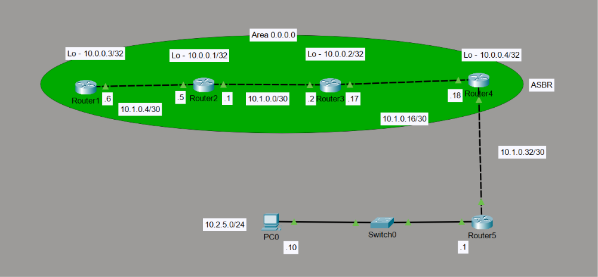

# OSPF Multi-Router Network with ASBR and Default Route Propagation

## Project Overview

This project demonstrates the implementation of a multi-router enterprise network using **Open Shortest Path First (OSPF)** as the interior gateway routing protocol.

The network consists of four OSPF routers operating within Area 0, with Router4 configured as an Autonomous System Boundary Router (ASBR) connecting the internal OSPF domain to an external network.

A default route is configured on the ASBR and advertised throughout the OSPF domain, allowing internal routers to reach external networks. A static return route is configured on the external router to provide connectivity back to the internal network.

The network was designed and implemented using Cisco Packet Tracer.

## Network Topology



## Network Architecture

The network consists of:

- **Router1, Router2, Router3 and Router4:** OSPF routers operating in Area 0.
- **Router4 (ASBR):** Connects the OSPF domain to the external network and advertises the default route.
- **Router5:** External router providing connectivity to the external LAN.
- **Switch0:** Layer 2 switch connecting the end device to Router5.
- **PC0:** End device connected to the external LAN.

## IP Addressing Scheme

### Router Interfaces

| Device | Interface | IP Address | Subnet Mask |
|---|---|---|---|
| Router1 | Loopback0 | 10.0.0.3 | /32 |
| Router1 | G0/0 | 10.1.0.6 | /30 |
| Router2 | Loopback0 | 10.0.0.1 | /32 |
| Router2 | G0/0 | 10.1.0.5 | /30 |
| Router2 | G0/1 | 10.1.0.1 | /30 |
| Router3 | Loopback0 | 10.0.0.2 | /32 |
| Router3 | G0/0 | 10.1.0.2 | /30 |
| Router3 | G0/1 | 10.1.0.17 | /30 |
| Router4 | Loopback0 | 10.0.0.4 | /32 |
| Router4 | G0/0 | 10.1.0.18 | /30 |
| Router4 | G0/1 | 10.1.0.33 | /30 |
| Router5 | G0/0 | 10.1.0.34 | /30 |
| Router5 | G0/1 | 10.2.5.1 | /24 |

### Network Segments

| Network | Subnet Mask | Purpose |
|---|---|---|
| 10.1.0.4/30 | 255.255.255.252 | Router1 – Router2 |
| 10.1.0.0/30 | 255.255.255.252 | Router2 – Router3 |
| 10.1.0.16/30 | 255.255.255.252 | Router3 – Router4 |
| 10.1.0.32/30 | 255.255.255.252 | Router4 – Router5 |
| 10.2.5.0/24 | 255.255.255.0 | External LAN |
| 10.0.0.0/32 – 10.0.0.4/32 | 255.255.255.255 | Router Loopback Interfaces |

## OSPF Configuration

OSPF Process ID 1 is configured on Router1, Router2, Router3 and Router4.

### OSPF Parameters

| Parameter | Configuration |
|---|---|
| Routing Protocol | OSPF |
| Process ID | 1 |
| OSPF Area | Area 0 |
| Router IDs | Loopback0 addresses |
| Interface Cost | 10 |
| Network Type | Point-to-Point Ethernet links |

### Router IDs

| Router | OSPF Router ID |
|---|---|
| Router1 | 10.0.0.3 |
| Router2 | 10.0.0.1 |
| Router3 | 10.0.0.2 |
| Router4 | 10.0.0.4 |

Loopback interfaces are configured and advertised in OSPF Area 0.

OSPF is enabled directly on the participating interfaces using the interface-level `ip ospf 1 area 0` command.

## Autonomous System Boundary Router (ASBR)

Router4 functions as the ASBR, providing connectivity between the internal OSPF domain and the external network through Router5.

A static default route is configured on Router4, pointing towards Router5.

```cisco
ip route 0.0.0.0 0.0.0.0 10.1.0.34
```

The default route is advertised into the OSPF domain using:

```cisco
router ospf 1
 default-information originate
```

This allows the internal OSPF routers to learn a default route for destinations outside the OSPF domain.

## External Network Configuration

Router5 connects the external LAN (10.2.5.0/24) to Router4.

A static route is configured on Router5 to provide a return path towards the internal OSPF network.

```cisco
ip route 10.0.0.0 255.0.0.0 10.1.0.33
```

### PC0 Configuration

| Parameter | Value |
|---|---|
| IP Address | 10.2.5.10 |
| Subnet Mask | 255.255.255.0 |
| Default Gateway | 10.2.5.1 |

## Technologies and Concepts Used

- Cisco Packet Tracer
- Open Shortest Path First (OSPF)
- OSPF Area 0
- OSPF Router ID Configuration
- Loopback Interfaces
- Point-to-Point /30 Subnetting
- Autonomous System Boundary Router (ASBR)
- Static Default Routing
- OSPF Default Route Origination
- Static Routing for Return Path
- IPv4 Addressing and Subnetting
- Layer 2 Switching

## Verification Commands

The following Cisco IOS commands can be used to inspect and verify the network configuration and routing operation.

```cisco
show ip interface brief
show ip route
show ip ospf neighbor
show ip protocols
show ip ospf database
```

Connectivity can also be tested using:

```cisco
ping 10.1.0.34
ping 10.2.5.10
traceroute 10.2.5.10
```

## Learning Outcomes

Through this project, I gained practical experience in:

- Implementing OSPF routing across multiple routers.
- Configuring OSPF Area 0 and router IDs.
- Using loopback interfaces for router identification.
- Configuring point-to-point networks using /30 subnetting.
- Implementing an ASBR to connect an OSPF domain with an external network.
- Configuring and advertising a default route through OSPF.
- Implementing static routing for external network return connectivity.
- Understanding routing between internal and external networks.

---

**Platform:** Cisco Packet Tracer  
**Project Category:** Network Routing  
**Focus:** OSPF, ASBR, Default Route Propagation and Static Routing
