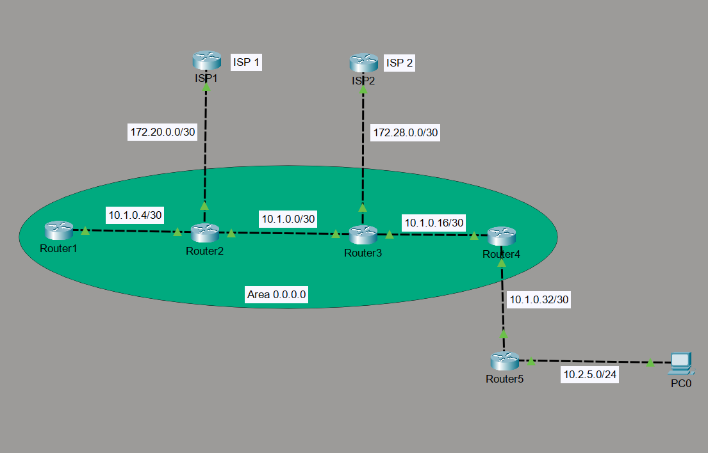

# OSPF Multi-Router Network with Dual ISP Connections

## Project Overview

This project demonstrates the configuration of a multi-router enterprise network using Cisco Packet Tracer. The network uses Open Shortest Path First (OSPF) as its dynamic routing protocol, with four routers operating within a single OSPF Area (Area 0).

The topology includes two ISP connections, static routing, OSPF route redistribution, default route advertisement, and a separate LAN connected through an edge router.

## Network Topology

## Network Objectives

- Design a multi-router network using Cisco Packet Tracer.
- Configure OSPF dynamic routing across multiple routers.
- Establish OSPF adjacencies within Area 0.
- Configure loopback interfaces and OSPF router IDs.
- Connect the routing network to two separate ISP routers.
- Configure static routes for external and LAN connectivity.
- Implement static route redistribution into OSPF.
- Configure and advertise a default route using OSPF.
- Provide LAN connectivity through an edge router.

## Network Devices

| Device | Role |
|---|---|
| Router1 | Internal OSPF router |
| Router2 | OSPF router and ISP1 gateway |
| Router3 | Internal OSPF router and ISP2 connection |
| Router4 | OSPF router and LAN gateway-side router |
| Router5 | LAN edge router |
| ISP1 | External ISP router 1 |
| ISP2 | External ISP router 2 |
| PC0 | LAN end device |

## IP Addressing Scheme

### Router-to-Router Networks

| Connection | Network Address | Subnet Mask |
|---|---|---|
| Router1 – Router2 | 10.1.0.4/30 | 255.255.255.252 |
| Router2 – Router3 | 10.1.0.0/30 | 255.255.255.252 |
| Router3 – Router4 | 10.1.0.16/30 | 255.255.255.252 |
| Router4 – Router5 | 10.1.0.32/30 | 255.255.255.252 |

### ISP Connections

| Connection | Network Address | Subnet Mask |
|---|---|---|
| Router2 – ISP1 | 172.20.0.0/30 | 255.255.255.252 |
| Router3 – ISP2 | 172.28.0.0/30 | 255.255.255.252 |

### LAN Network

| Parameter | Configuration |
|---|---|
| Network Address | 10.2.5.0/24 |
| Subnet Mask | 255.255.255.0 |
| Default Gateway | 10.2.5.1 |
| PC0 IP Address | 10.2.5.100 |

### Loopback Addresses

| Router | Loopback Interface | IP Address |
|---|---|---|
| Router1 | Loopback0 | 10.0.0.3/32 |
| Router2 | Loopback0 | 10.0.0.1/32 |
| Router3 | Loopback0 | 10.0.0.2/32 |
| Router4 | Loopback0 | 10.0.0.4/32 |

## Routing Configuration

### 1. OSPF Dynamic Routing

OSPF is configured using Process ID 1, with the internal routing network operating in Area 0.

The following routers participate in the OSPF domain:

- Router1
- Router2
- Router3
- Router4

Each router has a manually configured OSPF router ID.

### 2. Static Routing

Static routes are configured to provide connectivity between the routing domain, ISP connections, and the LAN.

- Router2 uses a default static route pointing towards ISP1.
- Router4 uses a static route to reach the LAN network through Router5.
- Router5 uses a default static route pointing towards Router4.
- ISP1 and ISP2 have default routes pointing towards their respective customer-facing routers.

### 3. Static Route Redistribution

Static route redistribution is configured on Router2 and Router4 using:

`redistribute static subnets`

This allows eligible static routes to be advertised into the OSPF routing domain.

### 4. Default Route Advertisement

Router2 is configured to advertise its default route into OSPF using:

`default-information originate`

This allows internal OSPF routers to learn the default route through OSPF.

## Technologies and Protocols Used

- Cisco Packet Tracer
- Cisco IOS
- OSPF (Open Shortest Path First)
- OSPF Area 0
- Static Routing
- Default Route Configuration
- Static Route Redistribution
- Loopback Interfaces
- IPv4 Addressing and Subnetting
- ISP Connectivity

## Verification and Testing

The following Cisco IOS commands can be used to verify the network configuration and routing information.

| Command | Purpose |
|---|---|
| `show ip interface brief` | Check interface status and IP addresses |
| `show ip route` | Examine the routing table |
| `show ip ospf neighbor` | Verify OSPF neighbor relationships |
| `show ip ospf interface brief` | Check OSPF-enabled interfaces |
| `show ip protocols` | Verify routing protocol configuration |
| `show running-config` | Examine device configurations |
| `ping <destination-ip>` | Test network connectivity |
| `traceroute <destination-ip>` | Examine the routing path |

## Project Files

- `topology.png` – Network topology diagram.
- `OSPF-Multi-Router-Network.pkt` – Cisco Packet Tracer project file.
- `README.md` – Project documentation.

## Learning Outcomes

Through this project, I gained practical experience in:

- Configuring OSPF across multiple routers.
- Understanding OSPF router IDs and Area 0.
- Configuring loopback interfaces.
- Implementing static and default routing.
- Understanding static route redistribution.
- Advertising default routes through OSPF.
- Connecting internal routing networks to ISP routers.
- Working with IPv4 addressing and point-to-point networks.

---

**Tools Used:** Cisco Packet Tracer | Cisco IOS
